# Pipelines DevOps en AWS

Aplicación web (frontend React + API FastAPI) que se prueba, se empaqueta y se despliega
en Amazon ECS Fargate mediante tres pipelines de GitHub Actions, con toda la
infraestructura definida en Terraform y sin una sola llave de acceso de AWS.

### Contenido de la entrega

| Se pide | Dónde está |
|---|---|
| Arquitectura | [2. Arquitectura](#2-arquitectura) |
| Requisitos | [7. Requisitos](#7-requisitos) |
| Pasos para reproducir la solución | [8. Reproducción paso a paso](#8-reproducción-paso-a-paso) |
| Enlace o evidencia de la demo | [15. Demo](#15-demo) |
| Pipelines | `.github/workflows/` (los que ejecuta GitHub) y su copia en `pipelines/workflows/` |

---

## Índice

1. [Resumen](#1-resumen)
2. [Arquitectura](#2-arquitectura)
3. [Los tres pipelines](#3-los-tres-pipelines)
4. [Terraform](#4-terraform)
5. [Credenciales y roles](#5-credenciales-y-roles)
6. [La aplicación](#6-la-aplicación)
7. [Requisitos](#7-requisitos)
8. [Reproducción paso a paso](#8-reproducción-paso-a-paso)
9. [Operación diaria](#9-operación-diaria)
10. [Destruir todo](#10-destruir-todo)
11. [Manejo de errores por capa](#11-manejo-de-errores-por-capa)
12. [Problemas encontrados y cómo se resolvieron](#12-problemas-encontrados-y-cómo-se-resolvieron)
13. [Decisiones de diseño y costos](#13-decisiones-de-diseño-y-costos)
14. [Estructura del repositorio](#14-estructura-del-repositorio)
15. [Demo](#15-demo)

---

## 1. Resumen

| Pieza | Qué hace | Dónde |
|---|---|---|
| **Bootstrap** | Crea, una sola vez, lo que los pipelines necesitan para existir: el bucket del estado de Terraform, el proveedor OIDC de GitHub y un rol de IAM por pipeline. | `terraform/bootstrap/` |
| **Pipeline 1 – Infraestructura** | Aplica (o destruye) con Terraform la red, el balanceador, ECR, ECS y los logs. | `.github/workflows/1-infra.yml` |
| **Pipeline 2 – Construcción** | Ejecuta las pruebas y, si pasan, construye las dos imágenes Docker, las publica en ECR y reporta el escaneo de vulnerabilidades. | `.github/workflows/2-build.yml` |
| **Pipeline 3 – Despliegue** | Despliega en ECS las imágenes que publicó el Pipeline 2 y verifica el resultado con una prueba de humo. También sirve para hacer rollback. | `.github/workflows/3-deploy.yml` |

El flujo normal es: **un push a `main` que cambia la aplicación dispara el Pipeline 2, y
cuando este termina con éxito se dispara automáticamente el Pipeline 3.** Un push que
cambia `terraform/infra/` dispara el Pipeline 1.

---

## 2. Arquitectura

```
                               Internet
                                  |
                                  |  HTTP :80
                                  v
 +------------------------ VPC 10.0.0.0/16 (us-east-1, 2 zonas) ------------------------
 |
 |  SUBREDES PÚBLICAS  10.0.0.0/24 · 10.0.1.0/24     ruta 0.0.0.0/0 -> Internet Gateway
 |
 |     +---------------------------------------------+
 |     |  ALB devops-final-alb                       |   SG: entrada 80 desde 0.0.0.0/0
 |     |    /api/*  -> target group backend  (8000)  |
 |     |    resto   -> target group frontend (8080)  |
 |     +----------------------+----------------------+
 |                            |  solo tráfico que viene del SG del ALB
 |  SUBREDES PRIVADAS  10.0.10.0/24 · 10.0.11.0/24   SIN ruta a internet (ni IGW ni NAT)
 |                            |
 |     +----------------------+    +----------------------+
 |     | Tarea Fargate        |    | Tarea Fargate        |   sin IP pública
 |     | backend  (FastAPI)   |    | frontend (nginx)     |
 |     +----------+-----------+    +-----------+----------+
 |                |        HTTPS 443           |
 |                +-------------+--------------+
 |                              v
 |     VPC endpoints de interfaz: ecr.api · ecr.dkr · logs      endpoint gateway: s3
 +---------------------------------------------------------------------------------------
                                |
                                v
                ECR (imágenes) · CloudWatch Logs · S3 (capas de las imágenes)
```

### Cómo viaja una petición

1. El navegador pide `http://<dns-del-alb>/`. El ALB es **el único punto público** del sistema.
2. El listener del puerto 80 revisa la ruta:
   - `/api/*` (regla de prioridad 10) → target group del **backend**, puerto 8000.
   - Cualquier otra ruta (acción por defecto) → target group del **frontend**, puerto 8080.
3. El frontend es una aplicación React estática servida por nginx. El navegador la descarga y
   luego llama a la API con **rutas relativas** (`/api/items`, `/api/version`). Como frontend
   y backend comparten el dominio del ALB, **no hace falta CORS**.

### Por qué las tareas no necesitan internet

Las tareas viven en subredes privadas **sin ruta 0.0.0.0/0**. Aun así, ECS necesita descargar
las imágenes y enviar los logs. Eso se resuelve con **VPC endpoints**, que llevan el tráfico a
los servicios de AWS por la red privada:

| Endpoint | Tipo | Para qué |
|---|---|---|
| `ecr.api` | Interfaz | Autenticación y manifiestos de ECR |
| `ecr.dkr` | Interfaz | Protocolo de registro Docker (`docker pull`) |
| `logs` | Interfaz | Driver `awslogs` hacia CloudWatch Logs |
| `s3` | Gateway | Las capas de las imágenes de ECR se guardan en S3 |

Los endpoints de interfaz tienen **DNS privado**: el nombre público del servicio
(`api.ecr.us-east-1.amazonaws.com`) resuelve a una IP privada dentro de la VPC, así que el
agente de ECS no necesita configuración especial.

### Security Groups encadenados

```
internet --80--> SG alb --8000/8080--> SG tareas --443--> SG endpoints
```

- **SG alb:** entrada 80 desde cualquier lugar; salida solo hacia el SG de las tareas, en los puertos 8000 y 8080.
- **SG tareas:** entrada solo desde el SG del ALB. La salida está abierta, pero la tabla de
  rutas privada solo permite llegar a destinos dentro de la VPC (endpoints) y a S3 por el
  endpoint gateway. **La tabla de rutas es el control real.**
- **SG endpoints:** entrada 443 solo desde el SG de las tareas.

---

## 3. Los tres pipelines

```
push a main
 |
 +-- cambia terraform/infra/** ------> PIPELINE 1  Terraform plan + apply
 |                                     (red, ALB, ECR, ECS, logs)
 |
 +-- cambia aplicacion/** -----------> PIPELINE 2  pruebas -> imágenes -> ECR
                                            |
                                            |  terminó con éxito (evento workflow_run)
                                            v
                                       PIPELINE 3  despliegue en ECS -> prueba de humo

Manual (Actions > Run workflow):
  Pipeline 1: apply, o destroy con confirmación
  Pipeline 2: reconstruir el commit actual
  Pipeline 3: desplegar cualquier SHA publicado (rollback)
```

Los tres pipelines tienen en común lo siguiente:

- **Autenticación solo por OIDC.** Cada pipeline asume **su propio rol**, y ninguno guarda llaves.
- **`mask-aws-account-id: true`.** El número de cuenta aparece como `***` en los logs.
- **Variables por entorno.** Los valores llegan a los scripts por `env:`, no interpolando
  `${{ }}` dentro de `run`, para evitar inyección de comandos.

### Pipeline 1 – Infraestructura (`1-infra.yml`)

| | |
|---|---|
| **Disparadores** | Push a `main` que cambia `terraform/infra/**` o el propio workflow. Ejecución manual con `accion: apply` o `destroy`. |
| **Rol** | `devops-final-gh-infra` (variable `AWS_ROLE_INFRA`) |
| **Concurrencia** | Grupo `terraform-infra`, sin cancelar: una segunda ejecución espera a la primera. |
| **Directorio** | `terraform/infra` |

| Paso | Qué hace |
|---|---|
| Validar la acción | Un push **siempre** resulta en `apply`. `destroy` solo es posible a mano y exige escribir `destruir` en la confirmación. Este paso va **antes** de pedir credenciales, así que un destroy sin confirmar nunca toca AWS. |
| Credenciales de AWS por OIDC | Asume el rol de infraestructura. |
| Identidad asumida | Imprime solo el **nombre** del rol (no el ARN completo). |
| Instalar Terraform | Versión fija 1.11.4, sin el *wrapper*, para que la salida sea texto plano. |
| `terraform fmt -check -recursive` | Falla si el código no tiene el formato estándar. |
| `terraform init` | El bloque `backend "s3"` no acepta variables, así que el bucket y la región se pasan con `-backend-config`. |
| `terraform validate` | Revisa la sintaxis y las referencias. |
| `terraform plan -out=infra.tfplan` | Con `destroy`, usa `plan -destroy`. El plan queda en el log como evidencia. |
| `terraform apply infra.tfplan` | Aplica **exactamente** el plan revisado, no uno nuevo. |
| `terraform output` | Solo en `apply`. |

### Pipeline 2 – Construcción (`2-build.yml`)

| | |
|---|---|
| **Disparadores** | Push a `main` que cambia `aplicacion/**`, y ejecución manual. |
| **Rol** | `devops-final-gh-build` (variable `AWS_ROLE_BUILD`), solo en el job `publicar`. |
| **Nombre** | `Pipeline 2 - Construccion`. El Pipeline 3 lo referencia por ese nombre exacto. |

**Job `pruebas`.** No tiene permiso para pedir el token OIDC, así que **no puede tocar AWS**.

| Paso | Qué hace |
|---|---|
| Python 3.11 + caché de pip | Instala `requirements.txt` y `requirements-dev.txt` y ejecuta `python -m pytest`. |
| Node 22 + caché de npm | Ejecuta `npm ci` y `npm run build`. El frontend no tiene pruebas unitarias; compilarlo detecta imports rotos y un `package-lock.json` desincronizado. |

**Job `publicar`.** Usa `needs: pruebas`, así que si una prueba falla, **nada llega a ECR**.
Es una matriz con `servicio: [backend, frontend]` y `fail-fast: false`.

| Paso | Qué hace |
|---|---|
| Login en ECR | Docker se autentica contra el registro de la cuenta. |
| Construir y publicar | **Idempotente.** Si `describe-images` ya encuentra la etiqueta `<SHA>`, termina sin construir. Si recibe `ImageNotFoundException`, construye con `--build-arg APP_VERSION=<SHA>` y hace push. Cualquier otro error (permisos, repositorio inexistente) detiene el job. |
| Esperar el escaneo | Espera a que exista el escaneo y luego a que termine. Es **informativo**: si falla, el job sigue (`continue-on-error`). |
| Resumen del escaneo | Escribe en el resumen de la ejecución la URI publicada (con la cuenta como `***`) y el conteo de hallazgos por severidad. |

Tres detalles de este pipeline:

- **Etiqueta = SHA completo del commit.** Los repositorios tienen etiquetas **inmutables**, así que un SHA
  siempre apunta a la misma imagen. Por eso el paso es idempotente: un *re-run* no intenta
  sobrescribir una etiqueta existente.
- **`--provenance=false --sbom=false`.** Sin estas opciones, Docker publica un *índice OCI*
  (imagen + attestation) y la etiqueta apunta al índice. El escaneo básico de ECR solo
  analiza manifiestos de imagen, así que la etiqueta quedaría sin escaneo. Ver la [sección 12](#12-problemas-encontrados-y-cómo-se-resolvieron).
- **El escaneo informa, no bloquea.** El enunciado pide visibilidad de vulnerabilidades. En
  producción se agregaría un umbral, por ejemplo fallar si hay hallazgos `CRITICAL`.

### Pipeline 3 – Despliegue (`3-deploy.yml`)

| | |
|---|---|
| **Disparadores** | `workflow_run` cuando termina el Pipeline 2 en `main`, y ejecución manual con la entrada obligatoria `image_tag`. |
| **Condición** | `workflow_dispatch` **o** el Pipeline 2 terminó con `success`. Si fallaron las pruebas, el Pipeline 3 aparece como *skipped*. |
| **Rol** | `devops-final-gh-deploy` (variable `AWS_ROLE_DEPLOY`) |
| **Concurrencia** | Grupo `despliegue-ecs`, sin cancelar: cortar un despliegue a medias dejaría un servicio en la versión nueva y el otro en la vieja. |

**Qué etiqueta se despliega:** `inputs.image_tag` si es manual, o
`github.event.workflow_run.head_sha` si es automático. **Nunca `github.sha`.** En un
`workflow_run`, `github.sha` es el último commit de `main` en el momento en que arranca el
Pipeline 3, no el que construyó el Pipeline 2. Si entre ambos llegó otro commit, se
intentaría desplegar una imagen que no existe o que no pasó las pruebas.

| Paso | Qué hace |
|---|---|
| Verificar que las imágenes existen | Exige un SHA de 40 caracteres y comprueba en ECR que **ambas** imágenes existan. Si falta alguna, falla con un mensaje claro **antes de tocar ECS**. |
| Dirección del registro | Arma `<cuenta>.dkr.ecr.<región>.amazonaws.com` con `sts get-caller-identity`. El rol de deploy no tiene `ecr:GetAuthorizationToken` porque no necesita descargar imágenes. |
| Preparar definición de tarea (backend) | `amazon-ecs-render-task-definition` toma la **última revisión registrada** de la familia y cambia **solo la imagen**. CPU, memoria, puertos, logs y rol de ejecución siguen siendo los de Terraform. |
| Desplegar backend | Registra la revisión nueva y actualiza el servicio con `desired-count: 1`. Espera hasta 10 minutos a que el servicio esté estable, consultando cada 15 s como máximo. |
| Frontend (mismos dos pasos) | Va **después** del backend: cuando el usuario ve el frontend nuevo, la API que llama ya es la nueva. |
| Prueba de humo | Ejecuta `pipelines/scripts/smoke-test.sh`. |

**Prueba de humo (`pipelines/scripts/smoke-test.sh`)**

1. Obtiene el DNS del ALB con `aws elbv2 describe-load-balancers --names devops-final-alb`.
2. Comprueba que `/` y `/api/health` respondan **200** exacto, con hasta 10 intentos separados por 10 s.
3. Comprueba con `jq` que `/api/version` devuelva **exactamente** la etiqueta desplegada.
   Si no coincide, termina con `exit 1`.
4. Un `trap EXIT` escribe siempre el resultado en el resumen de la ejecución: la URL de la
   aplicación, la etiqueta esperada y el detalle. Lo hace tanto si la prueba pasa como si falla.

El script usa `set -euo pipefail` y saltos de línea LF. `.gitattributes` fuerza LF en `*.sh`,
así que un checkout en Windows no lo rompe.

---

## 4. Terraform

La infraestructura está dividida en **dos configuraciones** con ciclos de vida distintos:

| | `terraform/bootstrap/` | `terraform/infra/` |
|---|---|---|
| **Qué crea** | Bucket del estado, proveedor OIDC y los 3 roles de los pipelines | Red, endpoints, ECR, logs, rol de ejecución, ALB y ECS |
| **Recursos** | 12 | 45 |
| **Estado** | Local (`terraform.tfstate`, fuera de git) | Remoto en S3: `infra/terraform.tfstate` |
| **Quién lo aplica** | Una persona, una sola vez, desde su equipo | El Pipeline 1 |
| **Versión de Terraform** | ≥ 1.10 | ≥ 1.11 (CI usa 1.11.4) |
| **Proveedor AWS** | `~> 5.92` | `~> 6.0` |

**Por qué dos configuraciones:** es un problema del huevo y la gallina. El Pipeline 1 necesita un rol
para autenticarse y un bucket para guardar el estado, así que esos recursos no pueden crearse
desde el propio Pipeline 1. El bootstrap los crea primero, con credenciales locales.

### `terraform/bootstrap/`

| Archivo | Contenido |
|---|---|
| `versions.tf` | Versiones requeridas. El provider recibe `region` y `profile` por variable. |
| `variables.tf` | `region`, `proyecto` (prefijo `devops-final`), `profile` y `github_sub`, con una validación que acepta los dos formatos del claim `sub` de GitHub. |
| `estado.tf` | Bucket `devops-final-tfstate-<cuenta>`: versionado (permite recuperar un estado anterior), cifrado AES256, acceso público bloqueado y `force_destroy` para poder borrarlo al final. |
| `oidc.tf` | Proveedor OIDC `token.actions.githubusercontent.com` con audiencia `sts.amazonaws.com`. |
| `roles.tf` | Los 3 roles de los pipelines y sus políticas. Ver la [sección 5](#5-credenciales-y-roles). |
| `outputs.tf` | `s3_bucket_name`, `rol_infra_arn`, `rol_build_arn` y `rol_deploy_arn`: los valores que se copian a las variables de GitHub. |
| `terraform.tfvars.example` | Plantilla del archivo de variables. El `terraform.tfvars` real está en `.gitignore`. |

### `terraform/infra/`

| Archivo | Recursos |
|---|---|
| `versions.tf` | Versiones y `default_tags` (`Proyecto`, `GestionadoPor`) aplicados a todos los recursos. |
| `backend.tf` | Backend S3 con `use_lockfile = true`: bloqueo nativo con un objeto `.tflock` en S3, sin DynamoDB. |
| `variables.tf` | `region`, `proyecto`, `vpc_cidr` (`10.0.0.0/16`) y `endpoints_en_todas_las_zonas` (por defecto `false`). |
| `locals.tf` | Zonas, nombres compartidos con el bootstrap y el mapa `apps` (backend: puerto 8000, health check `/api/health`; frontend: puerto 8080, health check `/`). Casi todo se crea con `for_each` sobre este mapa. |
| `network.tf` | VPC, Internet Gateway, 2 subredes públicas, 2 privadas y sus tablas de rutas. Solo la pública tiene ruta 0.0.0.0/0. |
| `security.tf` | 3 Security Groups y 7 reglas, cada una como recurso separado. |
| `endpoints.tf` | Endpoints de interfaz `ecr.api`, `ecr.dkr` y `logs`, y endpoint gateway de S3. |
| `ecr.tf` | 2 repositorios con etiquetas **inmutables**, `scan_on_push`, `force_delete` y una política de ciclo de vida que conserva las **10 imágenes más recientes**. |
| `logs.tf` | Log groups `/ecs/devops-final-backend` y `/ecs/devops-final-frontend` con retención de 7 días. |
| `iam.tf` | Rol de **ejecución** de ECS con `AmazonECSTaskExecutionRolePolicy`. |
| `alb.tf` | ALB, 2 target groups (tipo `ip`, matcher 200, *deregistration delay* de 30 s), listener HTTP y regla `/api/*`. |
| `ecs.tf` | Clúster, 2 definiciones de tarea (256 CPU / 512 MB, x86_64) y 2 servicios. |
| `outputs.tf` | URL del ALB, URLs de ECR, nombres del clúster, servicios y familias, y ARN del rol de ejecución. |

### Cómo convive Terraform con el Pipeline 3

Terraform crea la **primera** revisión de cada definición de tarea con la imagen
`<repositorio>:bootstrap`, que no existe, y los servicios con `desired_count = 0`. Así ECS no
intenta ejecutar nada hasta que hay una imagen real.

Después, el Pipeline 3 registra revisiones nuevas y sube el conteo a 1. Para que el siguiente
`terraform apply` no lo revierta, los servicios tienen:

```hcl
lifecycle {
  ignore_changes = [task_definition, desired_count]
}
```

Así se reparten las responsabilidades: **Terraform es dueño de la infraestructura, y el
Pipeline 3 es dueño de qué versión corre.** Después de un despliegue, el Pipeline 1 sigue diciendo
*No changes*.

Los servicios tienen además:
- `deployment_circuit_breaker` con `rollback = true`.
- 60 s de gracia antes de que cuenten los health checks.
- `depends_on` explícito al listener y a la regla, porque un servicio con balanceador exige que el target group ya esté asociado a un listener.

---

## 5. Credenciales y roles

### OIDC: cero llaves de acceso

```
GitHub Actions                                   AWS
--------------                                   ---
1. El job pide un token OIDC (JWT) a GitHub.
   Requiere permissions: id-token: write
2. configure-aws-credentials envía el token ---> STS AssumeRoleWithWebIdentity
                                                 3. STS valida la firma contra el proveedor
                                                    OIDC y las condiciones del rol:
                                                      aud = sts.amazonaws.com
                                                      sub = repo:<dueño>/<repo>:ref:refs/heads/main
4. Credenciales temporales (1 h) <-------------- 5. Si todo coincide, entrega credenciales
```

- En GitHub **no hay ningún secreto de AWS**. Las variables del repositorio son ARN y nombres:
  identificadores, no credenciales.
- Las credenciales duran como máximo una hora y mueren con el job.
- La condición `sub` limita el acceso a **la rama `main` de este repositorio**. Un fork, otra
  rama o un pull request no pueden asumir ningún rol.

### Un rol por pipeline, con mínimo privilegio

| Rol | Pipeline | Permisos | Qué **no** puede hacer |
|---|---|---|---|
| `devops-final-gh-infra` | 1 | `PowerUserAccess`, más una política de IAM limitada a roles `devops-final-ecs-*`: crear, borrar, leer, actualizar, etiquetar y listar. `Attach`/`Detach` solo de `AmazonECSTaskExecutionRolePolicy` (condición `iam:PolicyARN`) y `PassRole` solo hacia `ecs-tasks.amazonaws.com`. | Modificar los roles `devops-final-gh-*`, incluido el suyo: no puede darse más permisos. Tampoco adjuntar `AdministratorAccess` a nada. |
| `devops-final-gh-build` | 2 | `ecr:GetAuthorizationToken`; push, `BatchGetImage`, `DescribeImages` y `DescribeImageScanFindings` **solo en los 2 repositorios**. | Tocar ECS, la red o IAM, ni publicar en otros repositorios. |
| `devops-final-gh-deploy` | 3 | `RegisterTaskDefinition`, `DescribeTaskDefinition` y `elasticloadbalancing:Describe*`. `UpdateService` y `DescribeServices` **solo en los 2 servicios**. `ecs:TagResource` solo al registrar familias `devops-final-*`. `PassRole` solo del rol de ejecución hacia `ecs-tasks`. `ecr:DescribeImages`. | Crear infraestructura, publicar imágenes ni pasar otros roles. |
| `devops-final-ecs-ejecucion` | ECS | `AmazonECSTaskExecutionRolePolicy` | Lo usa **el agente de ECS**, no la aplicación, para descargar la imagen y escribir logs. |

Algunos puntos que suelen preguntar:

- **No hay rol de tarea.** La aplicación no llama a ninguna API de AWS, así que el código que
  corre en el contenedor **no tiene permisos de AWS**. Si un atacante comprometiera la
  aplicación, no obtendría credenciales.
- **Por qué `PowerUserAccess` en el Pipeline 1:** Terraform crea muchos tipos de recursos (EC2,
  ELB, ECS, ECR, Logs). `PowerUserAccess` los cubre pero **excluye IAM**, que se concede aparte y
  limitado. Es el rol menos restringido del proyecto. En producción se reemplazaría por una
  política por servicio.
- **El patrón `devops-final-ecs-*` evita la escalada de privilegios.** El rol de infraestructura puede crear
  roles, pero solo con ese prefijo, y solo puede adjuntarles la política de ejecución de ECS.
  Nunca puede tocar los `devops-final-gh-*`.

### Variables del repositorio

*Settings → Secrets and variables → Actions → Variables*

| Variable | Valor | Origen |
|---|---|---|
| `AWS_REGION` | `us-east-1` | Fijo |
| `TF_STATE_BUCKET` | Nombre del bucket del estado | `terraform output -raw s3_bucket_name` |
| `AWS_ROLE_INFRA` | ARN del rol del Pipeline 1 | `terraform output -raw rol_infra_arn` |
| `AWS_ROLE_BUILD` | ARN del rol del Pipeline 2 | `terraform output -raw rol_build_arn` |
| `AWS_ROLE_DEPLOY` | ARN del rol del Pipeline 3 | `terraform output -raw rol_deploy_arn` |

### Número de cuenta enmascarado

`configure-aws-credentials` con `mask-aws-account-id: true` registra el número de cuenta como
secreto del job: emite `::add-mask::<cuenta>`. A partir de ese paso, el runner reemplaza ese valor
por `***` en todas las líneas del log, incluidas las salidas de Terraform y los mensajes de error
de AWS.

Como el resumen de la ejecución se escribe aparte, el Pipeline 2 reemplaza la cuenta a mano en
la URI que publica ahí.

### Qué no está en el repositorio

`.gitignore` excluye `*.tfstate*`, `*.tfvars`, `*.tfplan`, `.terraform/`, `.env`,
`node_modules/`, `__pycache__/`, `.venv/` e `.idea/`. **Sí se versionan** los
`.terraform.lock.hcl`, que fijan las versiones exactas de los proveedores.

---

## 6. La aplicación

```
aplicacion/
├── backend/     API REST en FastAPI (Python 3.11)
├── frontend/    SPA en React + Vite, servida por nginx
├── gateway/     nginx que imita al ALB, solo para desarrollo local
└── compose.yaml entorno local completo
```

### Backend (`aplicacion/backend`)

| Ruta | Respuesta |
|---|---|
| `GET /api/health` | `{"status": "ok"}`. La usa el health check del ALB. |
| `GET /api/version` | `{"version": "<SHA del commit>"}`. La usa la prueba de humo. |
| `GET /api/items` | Lista de elementos. |
| `POST /api/items` | Crea un elemento a partir de `{"titulo": "...", "descripcion": "..."}`. Responde **201**, o **422** si falta el título. |

- Las dependencias son `fastapi 0.162.5` y `uvicorn 0.54.0`; para las pruebas, `pytest 9.2.0` y `httpx 0.28.1`.
- La imagen es `python:3.11-slim`. Se ejecuta con un usuario **sin privilegios** (`appuser`) en el puerto 8000.
- Hay **3 pruebas** en `tests/test_api.py`: el health check, crear y listar, y la validación que exige título.
- Los elementos se guardan **en memoria**. Es suficiente para demostrar el flujo, pero se pierden
  cuando la tarea se reemplaza en un despliegue. Una versión real usaría una base de datos.

### Frontend (`aplicacion/frontend`)

- React `19.3.1` con Vite `8.3.8`, compilado en una etapa con `node:22-alpine`.
- Servido por `nginxinc/nginx-unprivileged:1.30-alpine`, sin root, en el puerto 8080.
- `nginx.conf` redirige cualquier ruta inexistente a `index.html` (SPA). `index.html` va **sin
  caché**, así cada despliegue se ve al recargar. Los archivos de `/assets/`, que llevan hash en el
  nombre, se cachean un año.

### Trazabilidad de versiones

Los dos Dockerfiles reciben `--build-arg APP_VERSION=<SHA>`:
- El **backend** la guarda en la variable de entorno `APP_VERSION` y la expone en `/api/version`.
- El **frontend** la recibe como `VITE_APP_VERSION` al compilar.

El **pie de página** muestra los 7 primeros caracteres de las dos versiones. Así, en la
aplicación desplegada se ve qué commit corre en cada servicio.

### Desarrollo local

```powershell
# Entorno completo, con el mismo enrutamiento que el ALB:
cd aplicacion
docker compose up --build
# Abrir http://localhost:8081

# Pruebas del backend, desde la raíz del repositorio (pytest.ini fija pythonpath):
pip install -r aplicacion/backend/requirements.txt -r aplicacion/backend/requirements-dev.txt
python -m pytest
```

---

## 7. Requisitos

| Herramienta | Versión | Para qué |
|---|---|---|
| Cuenta de AWS | — | Región `us-east-1`. |
| Perfil de AWS CLI | — | Credenciales locales con permisos para crear el bucket, el proveedor OIDC y los roles. Solo se usan en el bootstrap. |
| AWS CLI | v2 | Configurar el perfil y hacer verificaciones. |
| Terraform | ≥ 1.11 (CI: 1.11.4) | Bootstrap (≥ 1.10) e infra (≥ 1.11, por `use_lockfile`). |
| Git | 2.x | Control de versiones. |
| Repositorio en GitHub | — | Con GitHub Actions habilitado. |
| Docker Desktop | Reciente | Entorno local con `compose`. En Windows, también para ejecutar Terraform si aparece el error `x509` (ver la [sección 12](#12-problemas-encontrados-y-cómo-se-resolvieron)). |
| Python | 3.11 | Opcional: pruebas locales del backend. |
| Node.js | 22 | Opcional: desarrollo local del frontend. |

Versiones de las acciones de GitHub que usan los pipelines:

| Acción | Versión |
|---|---|
| `actions/checkout` | v5 |
| `actions/setup-python` | v6 |
| `actions/setup-node` | v5 |
| `hashicorp/setup-terraform` | v4 |
| `aws-actions/configure-aws-credentials` | v6 |
| `aws-actions/amazon-ecr-login` | v2 |
| `aws-actions/amazon-ecs-render-task-definition` | v1 |
| `aws-actions/amazon-ecs-deploy-task-definition` | v2 |

Todas se ejecutan sobre Node 24.

---

## 8. Reproducción paso a paso

Los comandos son para PowerShell en Windows. En Linux o macOS son los mismos, cambiando
`Copy-Item` por `cp`.

### Paso 1 – Comprobar el perfil local

```powershell
$env:AWS_PROFILE = "devops-final"
aws sts get-caller-identity --query Arn --output text
```

**Esperado:** el ARN del rol o usuario local. Si da error, configura el perfil antes de seguir.

### Paso 2 – Bootstrap

```powershell
cd terraform/bootstrap
Copy-Item terraform.tfvars.example terraform.tfvars
```

Edita `terraform.tfvars`:

| Variable | Valor |
|---|---|
| `region` | `us-east-1` |
| `profile` | El nombre de tu perfil de AWS CLI |
| `github_sub` | El claim `sub` de los workflows de `main`. Ver abajo. |

**Cómo obtener `github_sub`.** GitHub usa dos formatos:
- **Anterior:** `repo:<dueño>/<repo>:ref:refs/heads/main`
- **Nuevo**, en repositorios creados desde el 15 de julio de 2026: `repo:<dueño>@<id-dueño>/<repo>@<id-repo>:ref:refs/heads/main`

Los IDs numéricos se obtienen con:

```powershell
gh api repos/<dueño>/<repo> --jq '.owner.id, .id'
```

La validación de la variable rechaza cualquier valor que no siga uno de los dos formatos.

```powershell
terraform init
terraform plan -out=bootstrap.tfplan
terraform apply bootstrap.tfplan
```

**Esperado:** `Apply complete! Resources: 12 added, 0 changed, 0 destroyed.`

```powershell
terraform output
```

**Esperado:** los 4 outputs (`s3_bucket_name`, `rol_infra_arn`, `rol_build_arn`,
`rol_deploy_arn`). No los pegues en documentos ni capturas: contienen el número de cuenta.

> ⚠️ El estado del bootstrap es **local**, en `terraform/bootstrap/terraform.tfstate`. Guárdalo:
> sin él, Terraform no puede actualizar ni destruir esos recursos. Está en `.gitignore` a
> propósito.

### Paso 3 – Variables en GitHub

En *Settings → Secrets and variables → Actions → Variables → New repository variable*, crea
las 5 variables de la [sección 5](#variables-del-repositorio). Obtén cada valor con
`terraform output -raw <nombre>` y pégalo directamente en GitHub.

### Paso 4 – Pipeline 1: infraestructura

*Actions → Pipeline 1 - Infraestructura → Run workflow*, con `accion: apply` y la confirmación vacía.
También se dispara con un push que cambie `terraform/infra/`.

**Esperado:**
- La primera vez: `Plan: 45 to add, 0 to change, 0 to destroy.` y `Apply complete! Resources: 45 added`.
- Los outputs, entre ellos `alb_url`.
- Los servicios de ECS existen con 0 tareas. Es lo normal hasta el paso 6.

### Paso 5 – Pipeline 2: imágenes

*Actions → Pipeline 2 - Construccion → Run workflow*, o un push que cambie `aplicacion/`.

**Esperado:**
- Pruebas en verde, y luego *Publicar backend* y *Publicar frontend* en paralelo.
- En el resumen, dos tablas: la URI `***.dkr.ecr.us-east-1.amazonaws.com/devops-final-<servicio>:<SHA>`,
  *Construida y publicada*, *Escaneo: COMPLETE* y el conteo por severidad.

Para comprobarlo desde la terminal:

```powershell
$sha = git rev-parse HEAD
foreach ($r in "devops-final-backend", "devops-final-frontend") {
  aws ecr describe-images --repository-name $r --image-ids imageTag=$sha `
    --query "imageDetails[0].[repositoryName,imageTags[0],imageScanStatus.status]" --output text
}
```

**Esperado:** cada repositorio con la etiqueta igual al SHA y `COMPLETE`.

### Paso 6 – Pipeline 3: despliegue

Arranca **solo** cuando el Pipeline 2 termina con éxito.

**Esperado:**
- *Verificar que las imágenes existen* muestra `OK` para los dos repositorios.
- Los dos despliegues esperan a que el servicio esté estable.
- El resumen muestra **Prueba de humo: Correcta**, con la URL de la aplicación.

Para comprobar el estado de los servicios:

```powershell
aws ecs describe-services --cluster devops-final --services devops-final-backend devops-final-frontend `
  --query "services[].{servicio:serviceName,deseadas:desiredCount,corriendo:runningCount,rollout:deployments[0].rolloutState}" `
  --output table
```

**Esperado:** `deseadas 1`, `corriendo 1` y `rollout COMPLETED` en los dos.

```powershell
foreach ($tg in "devops-final-backend-tg", "devops-final-frontend-tg") {
  $arn = aws elbv2 describe-target-groups --names $tg --query "TargetGroups[0].TargetGroupArn" --output text
  aws elbv2 describe-target-health --target-group-arn $arn `
    --query "TargetHealthDescriptions[].[Target.Id,TargetHealth.State]" --output text
}
```

**Esperado:** una IP privada (`10.0.10.x` o `10.0.11.x`) en estado `healthy` por cada target group.

### Paso 7 – Abrir la aplicación

Abre la URL del resumen del Pipeline 3 (output `alb_url` del Pipeline 1). En el pie de página
deben aparecer los 7 primeros caracteres del SHA desplegado en *Frontend* y *Backend*.

---

## 9. Operación diaria

| Quiero… | Cómo |
|---|---|
| **Desplegar un cambio de la aplicación** | Push a `main` con cambios en `aplicacion/`. El Pipeline 2 y luego el 3 corren solos. |
| **Hacer rollback** | *Actions → Pipeline 3 → Run workflow*, con el SHA completo de una versión anterior en `image_tag`. No reconstruye nada: reutiliza la imagen inmutable que ya está en ECR. |
| **Volver a la versión actual** | Igual que el rollback, con `git rev-parse HEAD`. |
| **Cambiar la infraestructura** | Editar `terraform/infra/` y hacer push. El Pipeline 1 muestra el plan en el log y lo aplica. |
| **Corregir un cambio manual hecho en la consola** | *Run workflow* del Pipeline 1 con `apply`. El plan detecta la diferencia (*drift*) y la revierte al valor del código. |

Ten en cuenta sobre el rollback:

- **La ventana de rollback son las últimas 10 imágenes** de cada repositorio, por la política de
  ciclo de vida de ECR.
- **El rollback cambia lo que corre, no el código de `main`.** Para dejarlo permanente,
  usa `git revert` del commit problemático: el flujo normal publicará y desplegará la versión
  revertida con un SHA nuevo.

Para obtener los SHA completos:

```powershell
git log --format="%H  %s" -10
```

---

## 10. Destruir todo

**El orden importa:** primero la infraestructura, y después el bootstrap. Si se destruye
antes el bootstrap, desaparecen el rol del Pipeline 1 y el bucket del estado, y ya no se puede
destruir la infraestructura con Terraform.

### 1. Infraestructura, con el Pipeline 1

*Actions → Pipeline 1 - Infraestructura → Run workflow*:
- `accion`: **destroy**
- `confirmacion`: **destruir**

**Esperado:** el plan muestra `Plan: 0 to add, 0 to change, 45 to destroy.` y el apply termina
con `45 destroyed`.

- Los repositorios ECR se borran con sus imágenes, gracias a `force_delete`.
- Los servicios se escalan a 0 antes de borrarse.

Las revisiones de las definiciones de tarea que registró el Pipeline 3 quedan como historial
en ECS. **No tienen costo.** Para eliminarlas, usa credenciales con permisos de ECS:

```powershell
foreach ($f in "devops-final-backend", "devops-final-frontend") {
  $arns = aws ecs list-task-definitions --family-prefix $f --query "taskDefinitionArns[]" --output text
  foreach ($a in $arns -split "\s+" | Where-Object { $_ }) {
    # Primero se desregistra (queda INACTIVE); solo entonces se puede borrar.
    aws ecs deregister-task-definition --task-definition $a | Out-Null
    aws ecs delete-task-definitions --task-definitions $a | Out-Null
  }
}
```

### 2. Bootstrap, desde tu equipo

```powershell
cd terraform/bootstrap
terraform plan -destroy -out=destroy.tfplan
terraform apply destroy.tfplan
```

**Esperado:** `12 destroyed`. El bucket se borra con todas sus versiones gracias a
`force_destroy`.

**Desde este momento, los pipelines ya no pueden autenticarse en AWS.**

### 3. Opcional, en GitHub

Borra las 5 variables del repositorio.

### Comprobar que no queda nada cobrando

```powershell
aws elbv2 describe-load-balancers --names devops-final-alb         # esperado: LoadBalancerNotFound
aws ec2 describe-vpcs --filters Name=tag:Proyecto,Values=devops-final --query "Vpcs[].VpcId"                # []
aws ec2 describe-vpc-endpoints --filters Name=tag:Proyecto,Values=devops-final --query "VpcEndpoints[].VpcEndpointId"   # []
aws ecs describe-clusters --clusters devops-final --query "clusters[?status=='ACTIVE'].clusterName"        # []
aws ecr describe-repositories --query "repositories[?starts_with(repositoryName,'devops-final')].repositoryName"  # []
aws ec2 describe-network-interfaces --query "NetworkInterfaces[?Association.PublicIp].[NetworkInterfaceId,Description]" --output table  # sin filas de devops-final
```

Sin la VPC, no puede quedar ninguna interfaz de red ni IP pública asociada al proyecto.

---

## 11. Manejo de errores por capa

| Capa | Mecanismo | Si algo falla… |
|---|---|---|
| **Código de Terraform** | `fmt -check`, `validate` y `plan` guardado | El pipeline se detiene antes de `apply`. Lo que se aplica es exactamente lo que se planificó. |
| **Estado de Terraform** | `use_lockfile` en S3, `concurrency` del Pipeline 1 y bucket versionado | Dos ejecuciones nunca escriben el estado a la vez. Un estado dañado se recupera de una versión anterior del objeto en S3. |
| **Destrucción accidental** | `destroy` solo es manual y exige escribir `destruir`. La validación va antes de pedir credenciales. | Un push nunca destruye. Un clic equivocado falla en el primer paso sin tocar AWS. |
| **Código de la aplicación** | Job `pruebas` sin credenciales y `needs: pruebas` | Una prueba rota deja *Publicar* en *skipped*: nada llega a ECR, y el Pipeline 3 no se ejecuta porque el 2 no terminó con éxito. |
| **Publicación de imágenes** | Idempotencia y etiquetas inmutables | Un *re-run* no reconstruye ni sobrescribe. Un error de ECR distinto de "no existe" detiene el job en vez de ocultarse. |
| **Vulnerabilidades** | Escaneo en cada push | Se informa en el resumen y no bloquea (decisión documentada). |
| **Imagen inexistente** | *Verificar que las imágenes existen* | El Pipeline 3 falla con un mensaje claro **antes de tocar ECS**. Los SHA cortos o inventados se rechazan. |
| **Permisos** | Un rol por pipeline, con mínimo privilegio | AWS responde `AccessDenied` con la acción y el recurso exactos, con la cuenta como `***`. Se corrige agregando solo esa acción en el bootstrap. |
| **Tarea que no arranca o no pasa el health check** | *Circuit breaker* con rollback y `wait-for-service-stability` (10 min) | ECS vuelve solo a la revisión anterior. El paso de despliegue falla y el pipeline queda en rojo, pero **la aplicación sigue sirviendo la versión anterior**. |
| **Despliegue a medias** | `concurrency` sin cancelar y orden backend → frontend | Nunca hay dos despliegues simultáneos. Si el backend falla, el frontend no se toca. |
| **Aplicación desplegada** | Prueba de humo | Si `/`, `/api/health` o `/api/version` no responden lo esperado, el pipeline falla y el resumen dice qué ruta falló. |
| **Versión equivocada en producción** | `/api/version` comparada con el SHA esperado | Detecta, por ejemplo, que la etiqueta que se desplegó no es la que se esperaba. |

---

## 12. Problemas encontrados y cómo se resolvieron

| Problema | Causa | Solución |
|---|---|---|
| `terraform validate` fallaba en Windows con `x509: certificate signed by unknown authority` | Algo en el equipo interceptaba la conexión TLS local entre Terraform y el plugin del proveedor. Desactivar el antivirus no lo resolvió. | Ejecutar Terraform en Docker (`hashicorp/terraform:1.11.4`), con el perfil de AWS montado en solo lectura. Ver `terraform/README.md`. |
| El nombre del bucket llegaba vacío a `terraform init` | PowerShell 5.1 parte `-chdir=../bootstrap` en dos argumentos. | Poner el argumento entre comillas: `terraform "-chdir=../bootstrap" output -raw s3_bucket_name`. |
| `AccessDenied ec2:GetSecurityGroupsForVpc` al crear el ALB desde el equipo local | El rol local solo tiene los permisos mínimos del bootstrap. | La infraestructura se aplica con el Pipeline 1, que usa el rol `gh-infra`. Es justamente su propósito. |
| El rol de deploy no podía actualizar los servicios | El nombre del clúster en la política era el texto literal `"var.proyecto"`. | Usar `var.proyecto` sin comillas y volver a aplicar el bootstrap. |
| `ScanNotFoundException` en todos los escaneos | `docker build` adjunta una *attestation de provenance* y publica un índice OCI. La etiqueta apunta al índice, que ECR no escanea. El indicio fue un manifiesto de 856 bytes, demasiado pequeño para una imagen con 10 capas. | Construir con `--provenance=false --sbom=false`. |
| `AccessDenied ecs:TagResource` en el primer despliegue | La acción de *render* copia los tags de la definición de tarea (los `default_tags` de Terraform), y registrar con tags exige ese permiso. | Agregar `ecs:TagResource` limitado a las familias `devops-final-*`, con la condición `ecs:CreateAction = RegisterTaskDefinition`. |
| Avisos de Node 20 en Actions | Las versiones anteriores de las acciones usaban Node 20, que GitHub está retirando. | Actualizar a la primera versión mayor con Node 24: `checkout@v5`, `setup-node@v5`, `setup-python@v6` y `setup-terraform@v4`. |

---

## 13. Decisiones de diseño y costos

### Decisiones

| Decisión | Alternativa descartada | Motivo |
|---|---|---|
| OIDC con credenciales temporales | Llaves de acceso en GitHub Secrets | No hay nada que filtrar ni que rotar, y el acceso se limita a la rama `main`. |
| Un rol por pipeline | Un solo rol para todo | Si un pipeline se compromete, el daño se limita a lo que ese pipeline hace. |
| Bootstrap separado, con estado local | Todo en una sola configuración | Rompe la dependencia circular entre el rol, el bucket y el pipeline que los usa. |
| Bloqueo nativo de S3 (`use_lockfile`) | Tabla de DynamoDB | Un recurso menos. Es estable desde Terraform 1.11. |
| VPC endpoints | NAT Gateway | Más barato en este caso y más privado: las tareas no tienen ninguna salida a internet. |
| Endpoints en una sola zona (por defecto) | En las dos zonas | Cuesta la mitad. Si esa zona falla, las tareas de la otra no pueden descargar imágenes. Se cambia con `endpoints_en_todas_las_zonas = true`. |
| Un ALB con enrutamiento por ruta | Dos balanceadores, o el frontend llamando al backend por otro dominio | Un solo punto público y sin CORS. |
| Fargate | ECS sobre EC2 | No hay servidores que parchear ni escalar. |
| Servicios con `desired_count = 0` e imagen `:bootstrap` | Que Terraform despliegue la aplicación | Terraform crea la infraestructura antes de que exista una imagen. Los pipelines no dependen uno del otro para crearse. |
| `ignore_changes` en los servicios | Que el Pipeline 3 modifique Terraform | Responsabilidades separadas: Terraform se encarga de la infraestructura y el Pipeline 3 de la versión que corre. |
| Etiqueta = SHA completo, inmutable | `latest` o etiquetas mutables | Cada despliegue es reproducible y rastreable, y el rollback es exacto. |
| Render por familia | Archivo JSON de la definición de tarea en el repositorio | Una sola fuente de verdad (Terraform) para CPU, memoria, puertos y logs. |
| Escaneo informativo | Bloquear por severidad | Lo pide el enunciado. El umbral es el siguiente paso natural. |
| Sin rol de tarea | Dar permisos a la aplicación "por si acaso" | La aplicación no usa AWS, así que no necesita credenciales. |

### Costos aproximados por hora (us-east-1)

Son precios públicos de referencia; conviene confirmarlos en la
[calculadora de AWS](https://calculator.aws/) antes de presupuestar.

| Recurso | Cálculo | USD/hora |
|---|---|---|
| Application Load Balancer | Cargo fijo + LCU con tráfico mínimo | ~0.025 |
| 3 VPC endpoints de interfaz | 3 × 0.01 (una zona) | 0.030 |
| 2 tareas Fargate (0.25 vCPU, 0.5 GB) | 2 × (0.25 × 0.04048 + 0.5 × 0.004445) | ~0.025 |
| 2 IPv4 públicas del ALB | 2 × 0.005 | 0.010 |
| Endpoint gateway de S3 | Sin cargo | 0.000 |
| ECR, CloudWatch Logs, S3 del estado | Centavos al mes con este volumen | ~0.000 |
| **Total con los servicios corriendo** | | **~0.09 (≈ 2.2 USD/día)** |
| Total con los servicios en 0 | | ~0.065 |

Como comparación, un **NAT Gateway** costaría 0.045 USD/hora, más 0.045 por GB procesado y
una IPv4 pública. Con los endpoints en una sola zona, este diseño es más barato y además no
tiene salida a internet. Con `endpoints_en_todas_las_zonas = true`, los endpoints pasan a
0.06 USD/hora.

> Para no gastar de más: destruye la infraestructura con el Pipeline 1 cuando no la uses
> (ver la [sección 10](#10-destruir-todo)). El bootstrap no tiene costo por hora.

---

## 14. Estructura del repositorio

```
.
├── .github/workflows/          Workflows que GitHub ejecuta (fuente de verdad)
│   ├── 1-infra.yml             Pipeline 1 – Infraestructura
│   ├── 2-build.yml             Pipeline 2 – Construcción
│   └── 3-deploy.yml            Pipeline 3 – Despliegue
├── pipelines/
│   ├── workflows/              Copia de los tres workflows (entrega)
│   └── scripts/
│       └── smoke-test.sh       Prueba de humo del Pipeline 3
├── terraform/
│   ├── README.md               Uso de Terraform desde el equipo local
│   ├── bootstrap/              Bucket del estado, OIDC y roles (estado local)
│   └── infra/                  Red, endpoints, ECR, logs, ALB y ECS (estado en S3)
├── aplicacion/
│   ├── backend/                FastAPI, Dockerfile y pruebas
│   ├── frontend/               React + Vite, nginx y Dockerfile
│   ├── gateway/                nginx que imita al ALB en local
│   └── compose.yaml            Entorno local
├── docs/
│   └── evidencias/             Capturas de la demo (sección 15)
├── pytest.ini                  Configuración de pytest para ejecutar desde la raíz
├── .gitattributes              Fuerza LF en *.sh
└── .gitignore                  Estado, tfvars, planes, .env y dependencias
```

### Por qué hay dos carpetas de workflows

**GitHub Actions solo ejecuta los archivos de `.github/workflows/`.** El enunciado del
proyecto pide entregar los pipelines en `pipelines/`, así que `pipelines/workflows/` contiene una **copia
idéntica**.

- La fuente de verdad es `.github/workflows/`. Si cambias un workflow, vuelve a copiarlo.
- Para comprobar que las copias coinciden, ejecuta este comando en Git Bash. No debe mostrar ninguna diferencia:
  ```bash
  diff -r .github/workflows pipelines/workflows
  ```

---

## 15. Demo

| Campo | Valor |
|---|---|
| **Evidencia** | Capturas de esta sección, en [`docs/evidencias/`](docs/evidencias/) |
| **Fecha de la demo** | 25 de noviembre de 2026 |
| **Commit desplegado durante la demo** | `dee76844b7dec551851d9d2b071920b67b8ec3d3` (pie de página: `dee7684`) |
| **Historial de ejecuciones** | Pestaña *Actions* del repositorio: Pipeline 1, 2 y 3 |

No se publica la URL de la aplicación: la genera AWS al crear el ALB y deja de funcionar
cuando se destruye la infraestructura. Las capturas de abajo son la evidencia permanente.

### Evidencias

Las capturas están en [`docs/evidencias/`](docs/evidencias/), en el orden del flujo:
infraestructura → construcción → despliegue → resultado.

| # | Qué demuestra | Qué se ve |
|---|---|---|
| 01 | **Pipeline 1** aplica Terraform con OIDC | `Apply complete!` y los outputs, con el número de cuenta como `***` |
| 02 | **Pipeline 1**: historial | Ejecuciones por push y manuales, todas en verde |
| 03 | **Infraestructura**: red | VPC `devops-final-vpc` con 2 subredes públicas y 2 privadas en dos zonas, tablas de rutas, Internet Gateway y endpoint de S3 |
| 04 | **Infraestructura**: ECR | Los repositorios `devops-final-backend` y `devops-final-frontend` |
| 05 | **Pipeline 2** publica y escanea | Las dos imágenes con el SHA como etiqueta, escaneo COMPLETE y hallazgos por severidad |
| 06 | **Pipeline 3**: mínimo privilegio | `AccessDenied ecs:TagResource`: el rol no tenía un permiso; se agregó solo esa acción |
| 07 | **Pipeline 3**: cadena 2 → 3 y prueba de humo | Disparado por `workflow_run`; prueba de humo *Correcta* con la etiqueta esperada |
| 08 | **Pipeline 3**: SHA inventado | Falla en *Verificar que las imagenes existen*; los pasos de despliegue quedan sin ejecutar y ECS no cambia |
| 09 | **ECS**: clúster | `devops-final` con 2 servicios y 2 tareas en ejecución, 0 instancias EC2 (Fargate) |
| 10 | **ECS**: servicios | Backend y frontend activos con 1/1 tareas, en la revisión 7 de su definición de tarea |
| 11 | **Aplicación** desplegada | La página servida por el ALB, con el SHA `dee7684` en el pie de página para frontend y backend |
| 12 | **ECR**: una imagen por commit | Cada etiqueta es el SHA completo de un commit; la más reciente (`dee7684…`) es la desplegada. Las dos más antiguas (`d4b216c…`, `abd1780…`) son de tipo *Image Index*, antes de `--provenance=false`; las siguientes ya son *Image* y por eso tienen escaneo |

#### 01 · Pipeline 1: apply y outputs enmascarados
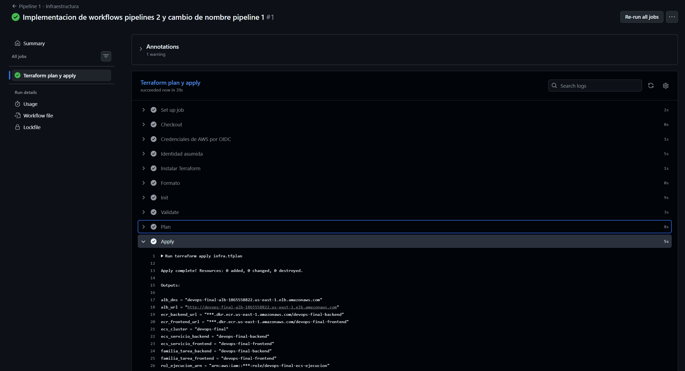

#### 02 · Pipeline 1: historial de ejecuciones
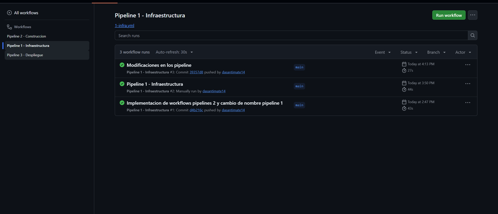

#### 03 · VPC y subredes
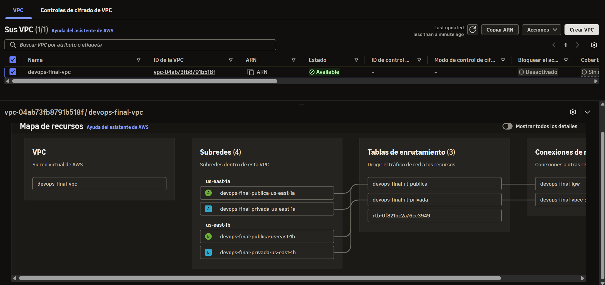

#### 04 · Repositorios de ECR
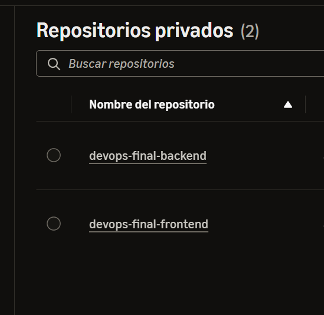

#### 05 · Pipeline 2: imágenes publicadas y escaneo
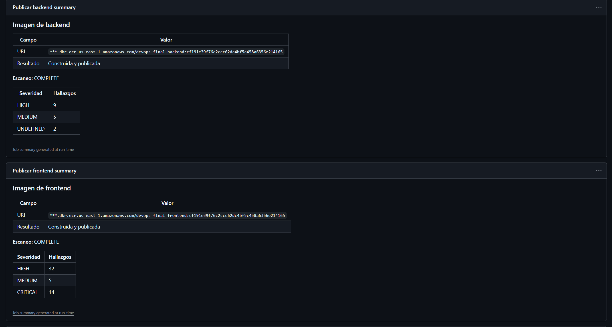

#### 06 · Pipeline 3: permiso faltante detectado
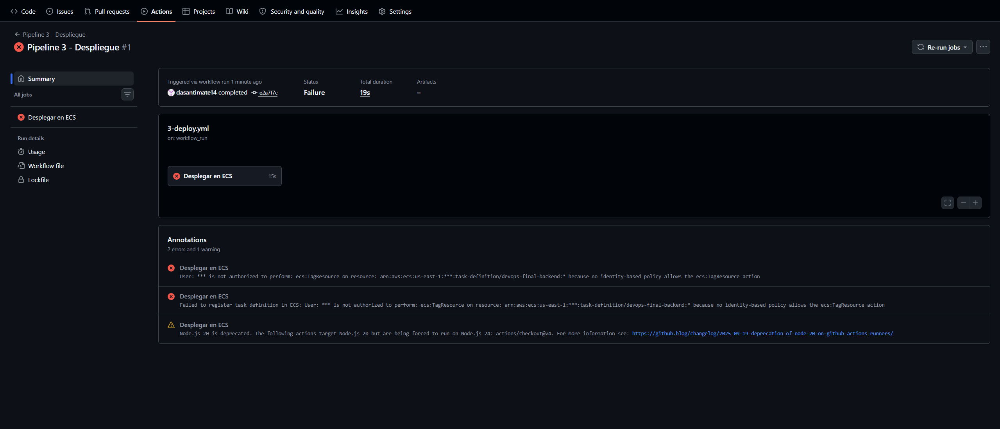

#### 07 · Pipeline 3: encadenamiento y prueba de humo
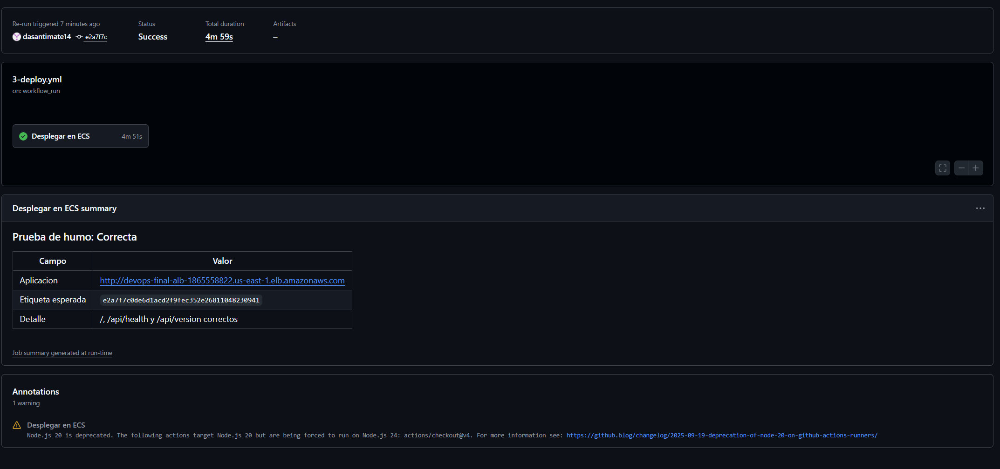

#### 08 · Pipeline 3: SHA inventado rechazado
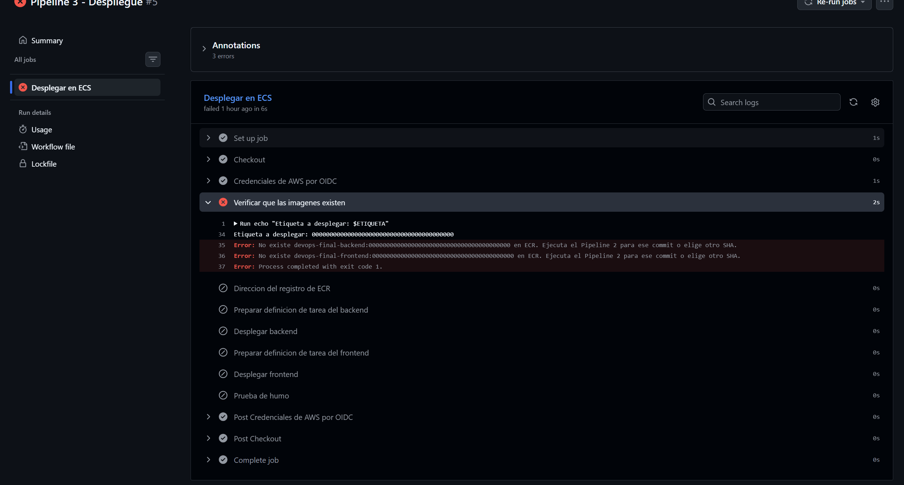

#### 09 · Clúster de ECS
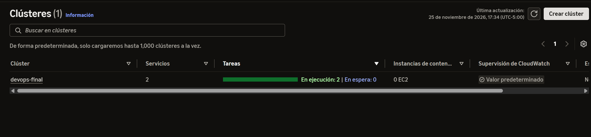

#### 10 · Servicios de ECS
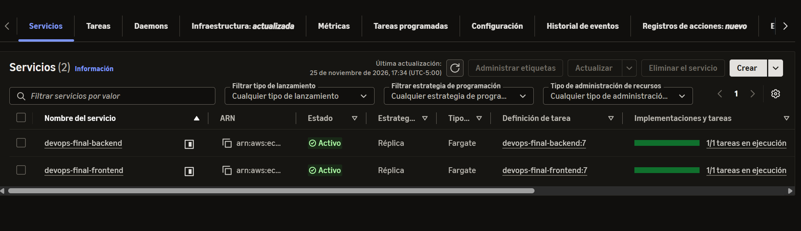

#### 11 · Aplicación desplegada
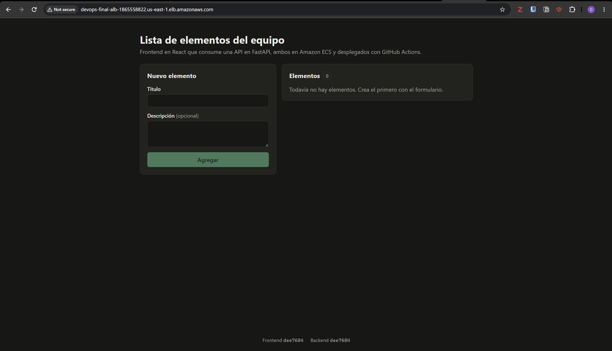

#### 12 · Imágenes en ECR etiquetadas con el SHA
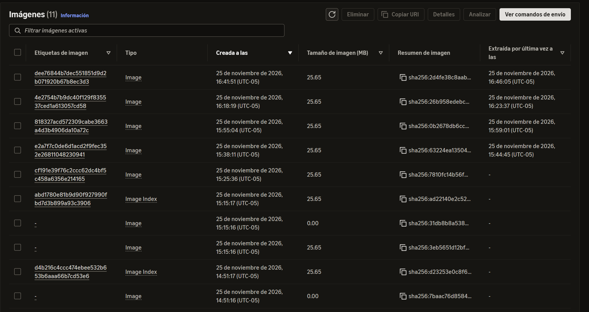

> Antes de subir una captura, revisa que no se vea el número de cuenta de 12 dígitos, ni el
> nombre completo del bucket del estado. En los logs de Actions aparecen como `***`; en la
> consola de AWS no se enmascaran.
